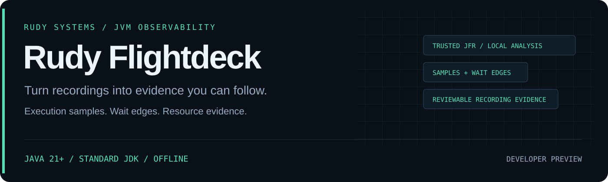

<p align="center"></p>

<p align="center">
  <a href="https://github.com/r4venrudy/rudy-flightdeck/actions/workflows/ci.yml"></a>
  
  <a href="LICENSE"></a>
  <a href="https://rudy.systems"></a>
</p>

**A Java service stalls. Its flight recording contains the clues. Flightdeck connects the samples, waits, resources, and capture gaps.**

Rudy Flightdeck is an offline Java Flight Recorder investigation engine written in Java. It streams `.jfr` events, builds weighted execution/allocation profiles, reconstructs historical monitor-owner edges, measures I/O and parking, unions top-level GC pause intervals, and compares recordings using observed rates and CPU sample mix.

Developer preview · Java 21+ · standard JDK only · no agent, database, build framework, or live JVM attachment.

## What you can investigate

| Question | Evidence |
| --- | --- |
| Where do execution samples concentrate? | Root-first stack groups, Java/native sample counts, focused stack visualization, Speedscope export |
| Which threads waited on which owners? | Historical monitor acquisitions, previous-owner edges, counts, summed blocked time, maximum duration |
| Is I/O contributing to stalls? | File/socket read and write counts, byte counts, durations, approximate p95 upper bounds, stable resource tokens |
| How much time overlaps recorded GC pauses? | Union of top-level `jdk.GCPhasePause` intervals; nested phase events and concurrent GC duration are excluded |
| What changed between captures? | Events per observed second, summed wait per second, CPU sample percentage-point changes, new/resolved warning IDs |
| Can someone review the result locally? | Self-contained HTML with stack focus, event timeline, searchable resources, contention and coverage tables |
| Is the evidence complete? | Event inventory, explicit data-loss status, missing CPU samples, stack truncation, input digest and application limits |

Counts describe recorded events, not all activity in the JVM. CPU samples are not CPU utilization. Allocation weights are estimates, not retained heap. Wait durations can overlap across threads. The tool makes investigation prompts, not vulnerability or deadlock verdicts.

## Quick start

Download a [release archive](https://github.com/r4venrudy/rudy-flightdeck/releases), verify its SHA-256 checksum, and extract it. Install a patched Java 21+ JDK/runtime that includes the `jdk.jfr` module.

```sh
bin/flightdeck analyze service.jfr
bin/flightdeck analyze service.jfr --format html --output investigation.html
bin/flightdeck analyze service.jfr --format speedscope --output profile.speedscope.json
bin/flightdeck compare baseline.jfr candidate.jfr --format html --output comparison.html
```

On Windows, use `bin\flightdeck.cmd`. The launchers use `JAVA_HOME` when configured and cap the JVM heap at 1 GiB. A direct JAR invocation works too:

```sh
java -Xmx1g -jar lib/rudy-flightdeck-0.1.0-preview.jar analyze service.jfr --format json
```

The HTML report opens locally without a server or external scripts. Speedscope files can be opened in a local or separately chosen Speedscope installation; Flightdeck never uploads them.

## Try a controlled recording

From the source checkout, create a small synthetic workload recording:

```sh
java examples/CaptureDemo.java demo.jfr
java -cp build/classes dev.rudy.flightdeck.Main analyze demo.jfr --format html --output demo.html
```

Build first using the commands below. The example writes a temporary synthetic file, creates deliberate monitor contention, parks a thread, exchanges bytes over loopback, computes a short CPU workload, throws a caught synthetic exception, and requests GC. It creates a **new** recording file and refuses an existing destination. Generated recordings are excluded from Git and release archives because even test recordings can contain host/runtime metadata.

For an existing service, use your organization's authorized JFR capture procedure. Flightdeck reads the resulting file and does not attach to or reconfigure that service.

## Build and test

Requirements: Java 21+ **JDK**. No Maven, Gradle, downloaded Java dependencies, or network access is needed by the build or tests.

```sh
java tools/Build.java test
java tools/Build.java package
java -jar dist/rudy-flightdeck-0.1.0-preview.jar --version
```

The build compiles with `--release 21 -Xlint:all -Werror`. The test suite combines deterministic aggregation/limit/format regressions with a real JDK-produced recording and local loopback fixtures. It creates illustrative reports under `build/examples/`. The Python standard-library helper `tools/verify_reports.py` optionally checks JSON and Speedscope export invariants independently; Python is not a tool runtime or build dependency.

GitHub Actions runs the suite on Linux, Windows, and macOS with Java 21 and 25. Tagged preview releases are published only after that matrix passes. The release includes the universal JAR, ZIP/tar.gz distributions, source examples, documentation, and `SHA256SUMS.txt`. Java itself is not bundled.

## CLI and CI gates

`analyze` supports `text`, `json`, `html`, and `speedscope`. `compare` supports `text`, `json`, and `html`. `--top 1..200` limits displayed rows per category; Speedscope retains all aggregated profile stacks within the application budgets.

```sh
bin/flightdeck analyze service.jfr --fail-on warning --format json --output findings.json
bin/flightdeck compare baseline.jfr candidate.jfr --fail-on warning --format json
```

In analysis, the gate fails on any warning. In comparison, it fails only on newly introduced warning IDs, not a second occurrence of an existing warning. A recording that reports JFR data loss always returns incomplete status. Output paths must be new: existing files, hard links, and symbolic links are refused.

| Exit | Meaning |
| --- | --- |
| `0` | Completed; requested warning gate not reached |
| `1` | Requested warning gate reached |
| `2` | Invalid input/usage, budget/output failure, or a recording reporting data loss |

Default path/endpoint values are full SHA-256 tokens and thread names are omitted. `--include-sensitive` explicitly includes those raw fields. Class and method symbols, thread IDs, and the input basename remain visible in both modes. Hashes are deterministic identifiers, not encryption or guaranteed anonymization.

## Application limits

| Budget | Default | Hard ceiling / option |
| --- | --- | --- |
| Input file | 512 MiB | 8 GiB / `--max-file-mib` |
| All decoded events, including unknown types | 2,000,000 | 20,000,000 / `--max-events` |
| Distinct aggregation entries and interned symbols, shared across maps | 100,000 | 1,000,000 / `--max-groups` |
| Retained frames per sampled stack | 128 | 512 / `--stack-depth`; deeper stacks are marked truncated |
| Top-level GC intervals | 100,000 | 1,000,000 / `--max-gc-intervals` |
| Retained symbol text | 8,000,000 characters total; 4,096 per symbol | Fixed |
| JSON/HTML text | 16 Mi characters | Fixed |
| Observed timestamp span | 366 days | Fixed |

**Use trusted recordings and a patched JDK.** The supported JDK JFR consumer decodes metadata before Flightdeck can inspect event budgets; these limits are not a parser sandbox or a guarantee against hostile recording files. Run unfamiliar inputs in an isolated process with OS memory/time controls. See [security boundaries](SECURITY.md).

## Design and evidence contract

- [Architecture and measurement semantics](docs/DESIGN.md)
- [Supported events and investigation thresholds](docs/EVENTS.md)
- [Validation and preview limits](docs/VALIDATION.md)
- [Contributing](CONTRIBUTING.md)

Flightdeck does not load recorded application classes, execute recorded commands, decode arbitrary object payloads, capture live traffic, claim exact quantiles, prove absence of activity, or establish a simultaneous deadlock graph. Unknown events are counted for coverage and budgets while their arbitrary fields are omitted.

Built on the JDK's [RecordingFile](https://docs.oracle.com/en/java/javase/21/docs/api/jdk.jfr/jdk/jfr/consumer/RecordingFile.html) and [RecordedEvent](https://docs.oracle.com/en/java/javase/21/docs/api/jdk.jfr/jdk/jfr/consumer/RecordedEvent.html) APIs. Profile export follows the [Speedscope file format](https://www.speedscope.app/file-format-schema.json).

**RUDY Systems · JVM observability** · [Project home](https://rudy.systems) · [MIT license](LICENSE)
